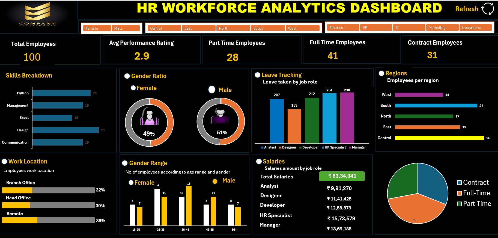

# 📊 SWYNEX Final Data Analytics Project

## HR Analytics | Employee Data Analysis & Interactive Dashboard

Transforming employee data into **meaningful business insights** using **Microsoft Excel**.

---

## 🚀 Project Overview

This project brings together my **HR data analysis** and **interactive dashboard** work completed during my SWYNEX internship. It demonstrates how employee data can be **organised, analysed, and visualised** to understand workforce patterns and support **informed HR decision-making**.

## 🎯 Problem Statement

Organisations need clear insights into their workforce to understand **employee distribution, employment patterns, and salary trends**. This project uses HR data analysis and visualisation to turn employee records into meaningful information for **workforce planning**.

## 📂 Dataset Information

The project uses an **HR employee dataset** containing fields such as:

- **Employee ID and Full Name**
- **Gender, Age, and Age Range**
- **Designation and Department**
- **Region and Work Location**
- **Manager/Supervisor and Date of Hire**
- **Employment Status**
- **Salary and Skills**, where available

## 🧹 Data Cleaning & Preparation

Data preparation involves reviewing data quality and checking relevant fields for **missing values, duplicate records, inconsistent formats, and appropriate data types**. The dataset is prepared for analysis using **Excel formulas, PivotTables, and charts**.

The final documentation will reflect the **cleaning steps actually performed**.

## 📈 Data Analysis

**Microsoft Excel** is used to explore workforce characteristics and summarise employee information, including:

- **Employee demographics and gender distribution**
- **Age-group and regional distribution**
- **Employment status**
- **Salary patterns**
- **Employee skills and designations**

**PivotTables, formulas, and charts** help organise the results and make patterns easier to interpret.

## 📊 Interactive HR Dashboard

The project builds on the **interactive HR dashboard** developed in Task 3. The dashboard brings together **key employee metrics, charts, and workforce visualisations** in a consolidated view.

### Dashboard Preview

## 💡 Key Business Insights

The analysis examines **workforce composition, employment categories, salary patterns, regional distribution, and employee skills**. These findings can help highlight workforce patterns and areas relevant to **HR planning**.
- **Workforce Size:** The dataset contains 100 employees.
- **Employment Status:** 41 Full-Time, 31 Contract, and 28 Part-Time employees.
- **Gender Distribution:** 51% Male and 49% Female employees.
- **Work Location:** 38% Remote, 32% Branch Office, and 30% Head Office.
- **Average Performance Rating:** 2.9.
- **Total Salaries:** ₹63,34,341, as displayed on the dashboard.

Specific insights and recommendations will be documented using the **actual results from the dataset and dashboard**.

## 🛠️ Tools & Technologies

- **Microsoft Excel** — Data preparation and analysis
- **PivotTables & Formulas** — Data summarisation and calculations
- **Charts & Visualisations** — Communicating analytical findings
- **GitHub** — Project documentation and sharing

## 🏁 Conclusion

This project demonstrates the **practical application of data analytics in Human Resources**. By combining **data preparation, analysis, and visualisation**, it turns employee records into organised insights that can support **workforce understanding and informed decision-making**.

## 👩‍💻 Project Details

- **Project:** SWYNEX Final Data Analytics Project
- **Domain:** Data Analytics
- **Focus Area:** Human Resources Analytics
- **Primary Tool:** Microsoft Excel
- **Internship Organisation:** SWYNEX Technologies

---

**Turning workforce data into meaningful insights.** 📊
